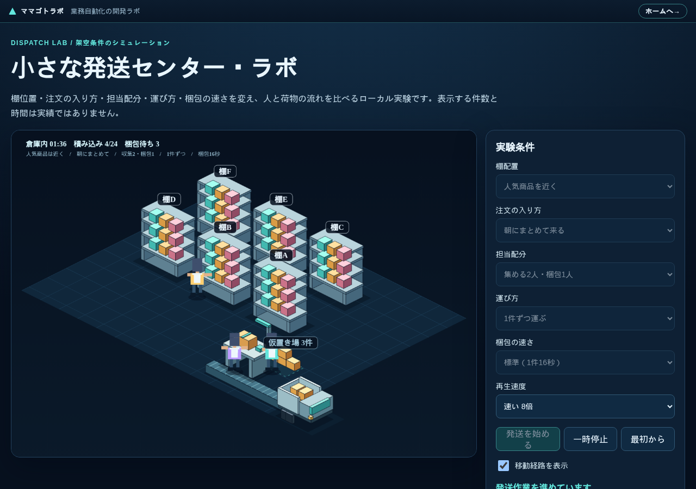

# 小さな発送センター・ラボ

固定24注文を使い、棚配置・注文の入り方・担当配分・運び方・梱包の速さによる人と荷物の流れを比較するブラウザー用シミュレーションです。数値は架空条件の計算結果であり、実績値や改善効果の保証ではありません。

**デモ（インストール不要）：https://mamagotolab.com/dispatch-lab/**



関連記事

- [出荷・発送作業のボトルネックの見つけ方──人を増やす前に「どこで待っているか」を見る](https://mamagotolab.com/blog/dispatch-bottleneck/)（この模型で分かること）
- [業務シミュレーションの数字を信じられる作りにする──整数tick・同時刻の処理順・不変条件テスト](https://qiita.com/mamagotolab/items/d2ae1dbf1f600d0b483b)（作り方と検証）

## 起動

```bash
npm install
npm run dev -- --port 43177 --strictPort
```

ブラウザーで `http://127.0.0.1:43177/dispatch-lab/` を開きます。終了は起動した端末で `Ctrl+C` です。

## 検証

```bash
python3 test_logic.py
```

型検査、単体テスト、ビルド、実ブラウザテストを順番に実行し、どれかが失敗すると非0で終了します。実ブラウザテストは専用ポート43176で自分用のサーバーを起動するため、上の開発サーバー（43177）を動かしたままでも実行できます。

## 画面の見かた

画面の上に、いま選んでいる5つの条件が1行で出ます。奥に棚が6つ（棚A〜棚F）並びます。棚名は注文の商品名です。手前が作業場で、梱包台（最大2台）、その手前に搬送ベルト、突き当たりにトラックがあります。棚と作業場の間の破線で囲った場所が梱包待ちの仮置き場です。箱は6個まで置き、合計件数は「仮置き場 N件」の札に出ます。4件以上たまると札と枠が黄色に変わります。梱包台は梱包担当の人数だけ並びます。

作業者は制服の色で見分けます。収集担当は棚まで歩いて商品を取り、1件ずつなら手に持ち、台車ありなら台車を押して荷台に載せて運びます。台車は棚や梱包台に重ならないよう、止まっているあいだは通路側へ寄せます。梱包担当は梱包台で箱を開け、商品を入れ、封をします。封が済んだ箱はベルトでトラックへ流れ、トラックの荷台に積み上がります。

## 選べる条件

| 条件 | 選択肢 |
| --- | --- |
| 棚配置 | 人気商品を近く／人気商品を奥へ |
| 注文の入り方 | 一定ペース（12秒ごと）／朝にまとめて来る（18件が最初の18秒に届き、残り6件は90秒以降）／波がある（8件ずつ3回、90秒おき） |
| 担当配分 | 収集1・梱包1／収集1・梱包2／収集2・梱包1／収集2・梱包2／収集3・梱包1 |
| 運び方 | 1件ずつ／台車で最大2件／3件／5件 |
| 梱包の速さ | 標準16秒／道具を整えた台12秒 |

注文24件と商品の並びはどの条件でも同じで、入り方は到着時刻だけを変えます。梱包台は2台までなので梱包担当は2人までです。

## 固定条件の完走値

1tickは100ミリ秒です。「最終」は最後の積み込みまでで、トラック出発80tickを含みません。平均は注文到着から積み込みまで、距離は収集担当の合計です。以下はすべて架空条件の計算結果です。

### 基準の8通り（注文=一定ペース、梱包=標準16秒）

| 棚配置 | 担当 | 運び方 | 最終tick | 平均tick | 距離m | 最大梱包待ち |
| --- | --- | --- | ---: | ---: | ---: | ---: |
| 人気商品を近く | 収集2・梱包1 | 1件ずつ | 4090 | 869.17 | 336 | 6 |
| 人気商品を近く | 収集2・梱包1 | 台車3件 | 4122 | 900.67 | 336 | 6 |
| 人気商品を近く | 収集1・梱包2 | 1件ずつ | 5260 | 1395.00 | 336 | 1 |
| 人気商品を近く | 収集1・梱包2 | 台車3件 | 3900 | 922.33 | 190 | 3 |
| 人気商品を奥へ | 収集2・梱包1 | 1件ずつ | 4280 | 1057.50 | 576 | 2 |
| 人気商品を奥へ | 収集2・梱包1 | 台車3件 | 4466 | 1232.67 | 366 | 6 |
| 人気商品を奥へ | 収集1・梱包2 | 1件ずつ | 7660 | 2785.00 | 576 | 1 |
| 人気商品を奥へ | 収集1・梱包2 | 台車3件 | 4720 | 1449.83 | 260 | 3 |

### 1つだけ条件を変えた場合

基準は「人気商品を近く／一定ペース／収集2・梱包1／1件ずつ／梱包16秒」です。

| 変えた条件 | 最終tick | 平均tick | 距離m | 最大梱包待ち |
| --- | ---: | ---: | ---: | ---: |
| 基準 | 4090 | 869.17 | 336 | 6 |
| 担当を収集1・梱包1へ | 5260 | 1395.00 | 336 | 1 |
| 担当を収集2・梱包2へ | 3350 | 441.67 | 336 | 2 |
| 担当を収集3・梱包1へ | 4090 | 869.17 | 336 | 6 |
| 台車2件 | 4122 | 900.67 | 336 | 6 |
| 台車5件 | 4122 | 900.67 | 336 | 6 |
| 朝にまとめて来る | 4070 | 1866.25 | 336 | 9 |
| 波がある | 4070 | 1260.00 | 336 | 8 |
| 梱包12秒 | 3310 | 453.33 | 336 | 2 |

この条件では、収集を3人にしても結果が1桁も動きません。待っているのが梱包側だからです。台車も同じで、注文が12秒に1件ずつしか来ないので荷台が埋まらず、2件でも5件でも同じ値になります。

### 朝にまとめて来る日に運び方を変えた場合

注文がたまっている日は、台車の積載数がそのまま効きます。

| 担当 | 運び方 | 最終tick | 平均tick | 距離m | 最大梱包待ち |
| --- | --- | ---: | ---: | ---: | ---: |
| 収集1・梱包2 | 1件ずつ | 5260 | 2411.25 | 336 | 1 |
| 収集1・梱包2 | 台車2件 | 4464 | 2039.17 | 232 | 2 |
| 収集1・梱包2 | 台車3件 | 3736 | 1802.08 | 178 | 3 |
| 収集1・梱包2 | 台車5件 | 3236 | 1615.33 | 128 | 5 |
| 収集2・梱包2 | 1件ずつ | 2910 | 1187.92 | 336 | 1 |
| 収集2・梱包2 | 台車3件 | 2396 | 1136.83 | 192 | 6 |
| 収集2・梱包2 | 台車5件 | 2544 | 1272.50 | 178 | 8 |

収集を2人にすると台車5件は3件より遅くなります。集める速さが上がるほど、梱包の前に荷物が積み上がるためです。

ビルド時の初期生成物はHTML 4.16kB、CSS 2.86kB、JavaScript 36.13kB（圧縮前）です。ローカルのPlaywright Chromium（1280×900、120フレーム）ではフレーム間隔の中央値16.7ms、95パーセンタイル16.8msでした。これは当該PC上の参考値で、実機スマートフォンの性能を示しません。外部フォント、CDN、外部APIはありません。サイト共通のアクセス解析（Cloudflare Web Analytics）だけは公開ページで読み込みます。Content-Security-Policyはその2つのドメインだけを許可し、ほかの外部通信は禁止しています。

## ビルド

```bash
npm run build    # dist/ に静的ファイルを出力（base は /dispatch-lab/）
```

`dist/` をそのまま静的ホスティングに置けば動きます。`npm run export` は作者のサイト（mamagotolab.com）へ書き出すための作者用スクリプトで、2階層上に `portfolio/` がある環境でだけ動きます。ページには、サイト共通の戻りバーと、外部通信を制限する Content-Security-Policy を入れてあります。

## データと対象外

結果と比較基準はブラウザーのメモリだけに保持し、再読込で消えます。選んだ条件や結果を保存または外部送信しません。公開ページではサイト共通のアクセス解析が訪問を数えますが、画面の操作内容は送りません。実在庫、入庫、欠品、複数商品注文、重量、衝突、費用、複数トラック、休憩・残業・習熟は対象外です。梱包台は最大2台、収集担当は最大3人までです。スマートフォンは360px・390pxの模擬表示を検証済みですが、実機の性能と操作感は未検証です。

## ライセンス

MIT License。作成：[ママゴトラボ](https://mamagotolab.com)（業務の自動化ツールを要件定義から設計してつくる開発ラボ）
